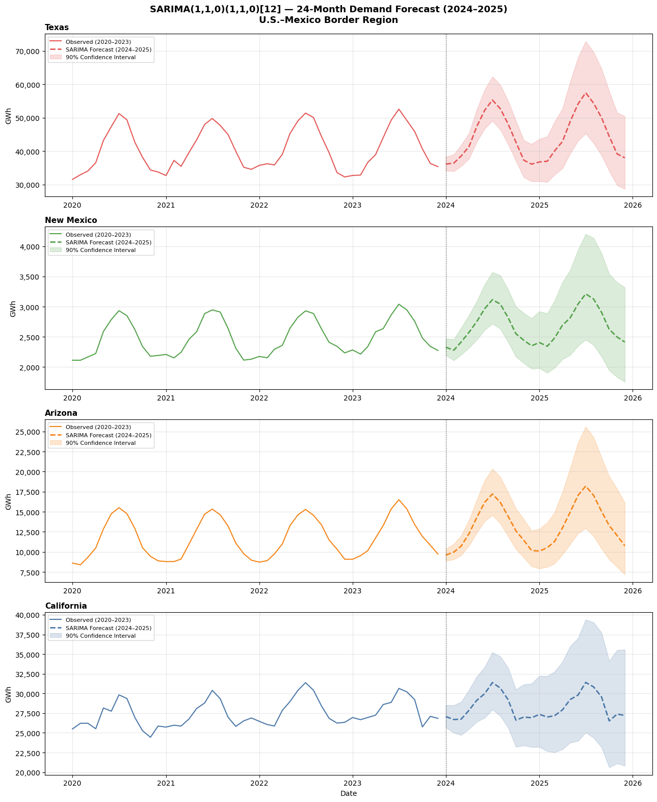
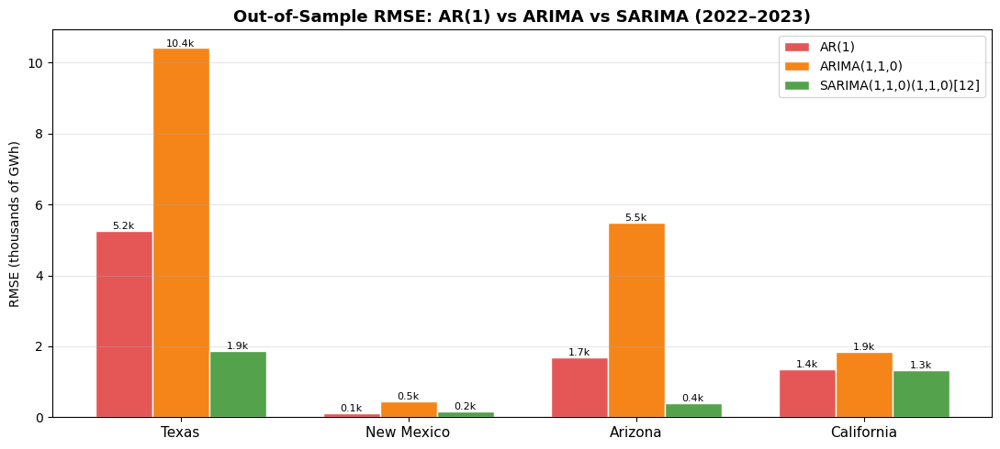
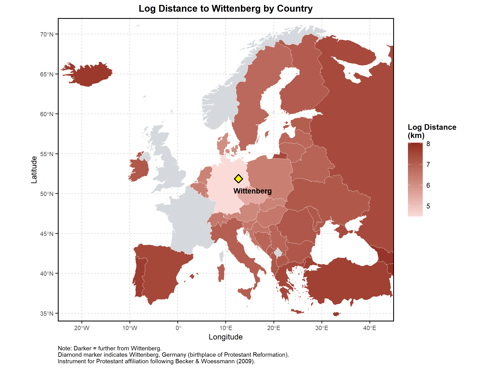
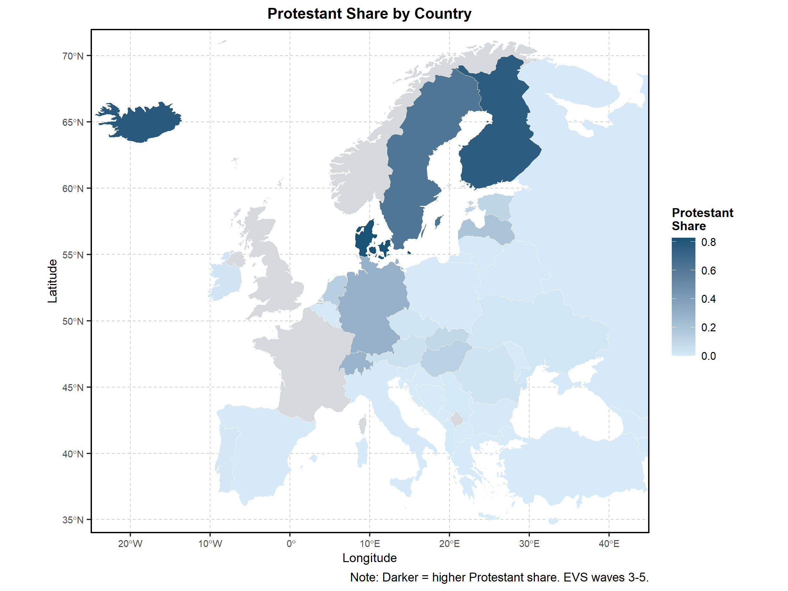
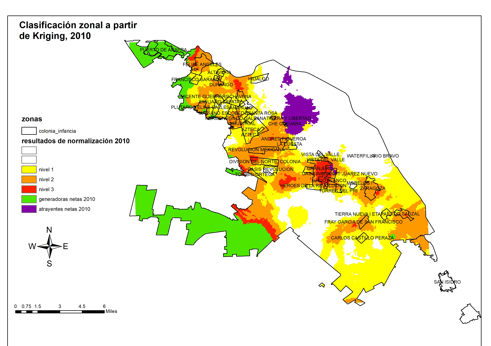
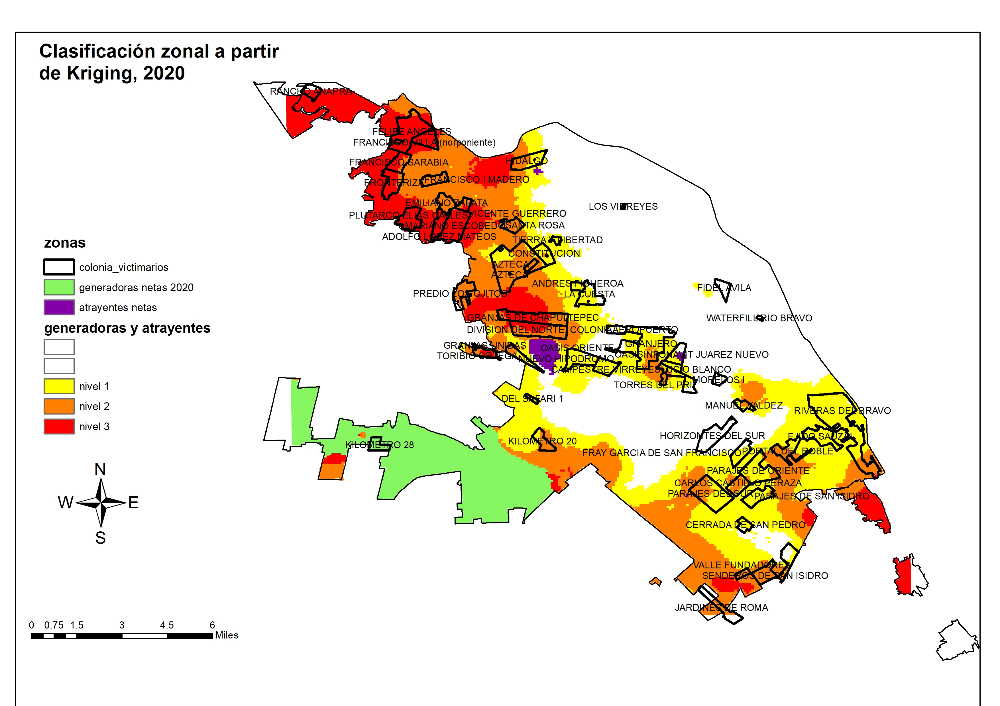
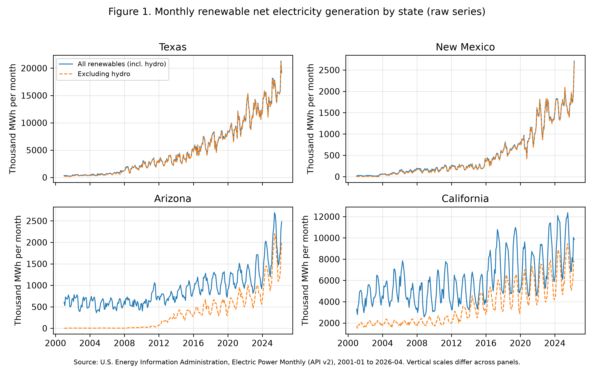

## Selected projects

### Electricity demand forecasting in the U.S.–Mexico border region

*Time series analysis · Python (statsmodels)*

How does electricity demand evolve across the border states, and which time series model forecasts it best? I use monthly retail electricity sales from the U.S. Energy Information Administration for Texas, New Mexico, Arizona, and California (2001–2023). Augmented Dickey-Fuller tests, seasonal decomposition, and heatmaps show that every series has both a long-run trend and a strong summer seasonal cycle. I compare an AR(1) on the year-over-year growth rate, an ARIMA(1,1,0), and a SARIMA(1,1,0)(1,1,0)[12], trained on 2001–2021 and evaluated on a 24-month out-of-sample window.

{width=75%}

{width=75%}

### Does a Protestant work ethic exist?

*Microeconometrics · OLS and instrumental variables · Stata*

This project estimates the effect of Protestant affiliation on individual work ethic using the Integrated Values Survey (EVS and World Values Survey, waves 3–5) for 47 European countries and about 130,000 respondents. The OLS models add country and wave fixed effects, religious attendance, and a belief index, with standard errors clustered by country. To address selection into religion, I also instrument Protestant affiliation with the log distance from each country's capital to Wittenberg, following Becker and Woessmann (2009). The first stage is strong (F-statistic of about 1,526).

The OLS estimates show a positive and significant Protestant coefficient (about 0.054). It falls by roughly 17% when the belief index is added, so both affiliation and beliefs seem to matter. The 2SLS estimate is positive but statistically insignificant, so the evidence does not establish a causal effect. Because the instrument varies only across countries, the IV models cannot include country fixed effects.

{width=85%}

{width=85%}

### Spatial relationship between intentional homicides and the socioeconomic conditions of perpetrators in Ciudad Juárez

*Spatial statistics and geostatistics · ArcGIS, GeoDa*

Homicides in Ciudad Juárez cluster in specific parts of the city. This project asks what the socioeconomic conditions of the places where perpetrators live, such as educational lag, low income, and marginalization, tell us about where homicides come from. Drawing on economic and ecological theories of crime, I build social and economic variables at the level of urban census areas (AGEBs) and use kriging interpolation to estimate the probability that a person commits a homicide in each area. The results classify areas as net generators or net attractors of offenders.

{width=75%}

{width=75%}

## Work in progress

### Policy uncertainty and renewable energy generation in the U.S.–Mexico border states

*Time series econometrics · Python*

This ongoing project studies how economic policy uncertainty and climate policy uncertainty relate to renewable electricity generation in Texas, New Mexico, Arizona, and California, using 304 monthly observations from January 2001 to April 2026. The data come from the EIA Electric Power Monthly and from published policy uncertainty indices, and I plan to test for unit roots and structural breaks around the 2008 financial crisis, COVID-19, Winter Storm Uri, and state regulatory changes. Results will be posted here as the analysis develops.

{width=80%}

